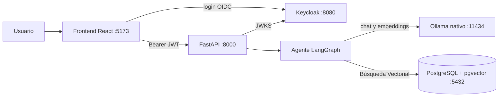

# ARQUITECTURA — DataTutor

**DataTutor** es un tutor RAG sobre libros y papers de bases de datos, ingeniería de datos y ciencia de datos. Responde solo con lo recuperado, cita documento y página, y rechaza explícitamente cuando no hay contexto suficiente.

## 1. Hechos del entorno

- Windows, PyCharm (backend), WebStorm o VS Code (frontend). **16 GB de RAM, sin GPU.** Todo gratuito.
- Keycloak ya funcionó antes en un proyecto del estudiante.
- ngrok **no** funciona en el campus (sí fuera).
- Los libros tienen copyright: el corpus **no** va al repositorio.

## 2. Stack (decisiones firmes)

| Capa            | Decisión                                                                            |
| --------------- | ------------------------------------------------------------------------------------ |
| Backend         | Python 3.12 + FastAPI, gestor`uv`. Desarrollo desde **PyCharm en el host**.  |
| Agente          | LangChain + LangGraph,`StateGraph` explícito.                                     |
| LLM de chat     | Ollama**nativo en Windows**. `qwen2.5:3b` por defecto.                       |
| Embeddings      | Ollama`bge-m3` (1024 dim).                                                         |
| Datos           | **PostgreSQL 16 + pgvector** (vía Docker). ORM: `SQLAlchemy`. |
| Autenticación  | **Keycloak** en Docker (OIDC, Authorization Code + PKCE).                      |
| Frontend        | React + Vite +`keycloak-js`.                                                       |
| Extracción PDF | PyMuPDF por página.                                                                 |
| Ingesta         | `BackgroundTasks` con estados `pending → processing → ready/failed`.           |

## 3. Diagrama

## 4. Dónde corre cada pieza (desarrollo y demo en el campus)

| Pieza      | Dónde                                       | Dirección          |
| ---------- | -------------------------------------------- | ------------------- |
| Ollama     | Windows, nativo                              | `localhost:11434` |
| Keycloak   | Docker (compose) | `localhost:8080`  |
| API        | PyCharm, en el host                          | `localhost:8000`  |
| Frontend   | Vite (`npm run dev`)                       | `localhost:5173`  |
| PostgreSQL | Docker                                       | `localhost:5432`  |

Con esto, **la demo presencial funciona 100% offline solo con el portátil**. No se usa ngrok ni proxy en las fases 0 a 6, ni se requiere conexión a internet para consultar la base de datos.
Como la API corre en el host, el emisor (iss) del token y la dirección de las claves son la misma `(http://localhost:8080/realms/datatutor)`: no hace falta ninguna configuración adicional.

## 5. Despliegue público (solo Fase 7)

Objetivo: cumplir el requisito de URL pública para frontend y backend y dejar evidencia. **Se hace fuera del campus** (ngrok está bloqueado dentro). Frontend en Vercel o Netlify; backend (y Keycloak) en el portátil expuestos con ngrok. La base de datos (PostgreSQL) se mantiene local en la máquina y no necesita ser expuesta a internet, ya que solo la API se comunica con ella. Los detalles (un solo host para API y Keycloak, emisor del token, CORS) se resuelven en esa fase y **no condicionan** el diseño anterior. En la sustentación se demuestra el sistema local y se muestra la evidencia del despliegue (capturas y video).

## 6. Presupuesto de RAM (aproximado; medir en la máquina)

Windows + IDE ~4–5 GB · modelo 3B ~2–3 GB (7B ~5–6 GB) · bge-m3 ~1,5 GB · Keycloak ~1 GB · PostgreSQL ~300 MB. Con 7B queda poco margen; el 3B es el modelo por defecto.

## 7. Seguridad (resumen)

Todo endpoint protegido salvo `/health`. JWT validado (firma, `iss`, `exp`, `aud`/`azp`). Cada consulta filtra por `owner_id = sub`. Subidas validadas (tamaño, extensión, tipo). CORS solo para el origen del frontend. Secretos solo en `.env`.

## 8. Riesgos

| Riesgo                                                      | Mitigación                                                                                                                 |
| ----------------------------------------------------------- | --------------------------------------------------------------------------------------------------------------------------- |
| RAM justa con 7B + Keycloak                                 | Usar el 3B; medir temprano                                                                                                  |
| Calidad de extracción de PDF (tablas, fórmulas, escaneos) | Auditoría previa; dejar fuera libros muy matemáticos en la v1                                                             |
| Pérdida de datos en PostgreSQL                             | Configurar un volumen persistente (pgdata) en Docker Compose para que los embeddings sobrevivan a reinicios del contenedor. |
| CPU lenta en generación                                    | `NUM_PREDICT=512`, `TOP_K=4`, streaming, `OLLAMA_KEEP_ALIVE` alto                                                     |
| Copyright de los libros                                     | Corpus fuera del repo; solo citas cortas; acceso tras login                                                                 |
